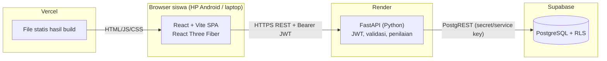
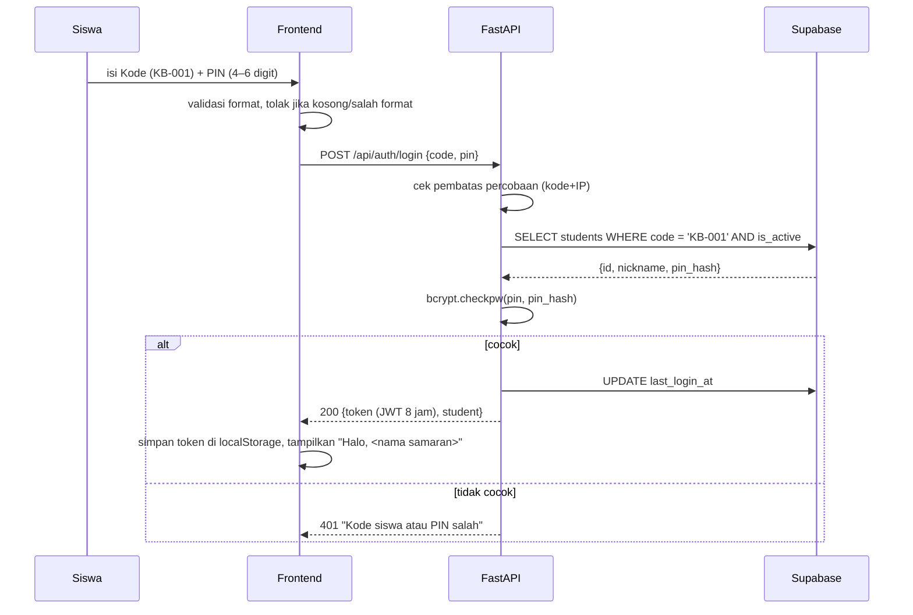

# Arsitektur — Belajar Kubus dan Balok

## 1. Gambaran umum

Prinsip utama:

1. **Browser tidak pernah berbicara langsung dengan Supabase.** Satu-satunya pintu adalah FastAPI. Karena itu tidak ada kunci Supabase apa pun di frontend — termasuk *anon key*.
2. **Secret/service-role key hanya ada di environment variable Render.**
3. **Penilaian evaluasi dilakukan di server.** Kunci jawaban tidak pernah dikirim ke browser sebelum evaluasi dikumpulkan.
4. **RLS aktif di semua tabel** sebagai lapisan pertahanan kedua: jika suatu saat *anon key* bocor/terpakai, tabel tetap tertutup.

## 2. Komponen

### Frontend (`frontend/`)

| Folder | Isi |
|---|---|
| `src/pages/` | Satu file per halaman (Landing, Login, Home, Materials, MaterialDetail, Visualization, Practice, PracticeSession, Evaluation, EvaluationSession, EvaluationResult, Results, ResultDetail, Guide, NotFound) |
| `src/components/` | Komponen UI umum: Layout, MenuCard, Icon, AnswerInput, Feedback, SolutionSteps, ProgressBar, Stars, OfflineBanner, StatusMessage |
| `src/features/shapes/` | Visualisasi: `ShapeViewer3D` (R3F), `Shape2D` (SVG), `ShapeFigure` (pemilih 3D/2D + ErrorBoundary), deteksi WebGL |
| `src/features/practice/` | Pembangkit soal latihan acak per level |
| `src/features/materials/` | Perender blok materi (teks, rumus, langkah, contoh soal) |
| `src/services/api.js` | Klien REST: timeout, pembedaan galat jaringan/server/autentikasi |
| `src/hooks/` | `useAuth` (konteks login), `useOnlineStatus`, `useCountdown` |
| `src/utils/number.js` | Parser & format angka Indonesia (sama aturannya dengan backend) |

Three.js dimuat **lazy** (`React.lazy`) sehingga halaman awal dan login tetap ringan di HP.

### Backend (`backend/app/`)

| Folder | Isi |
|---|---|
| `main.py` | Membuat aplikasi FastAPI, CORS, handler galat |
| `core/` | `config.py` (env), `security.py` (bcrypt, JWT, pembatas percobaan login) |
| `api/` | Router: `auth`, `materials`, `evaluations`, `practice`, `attempts`, `health` + dependensi `get_current_student` |
| `schemas/` | Model Pydantic request/response (validasi input) |
| `models/` | Konstanta domain (mode, status, tipe soal) |
| `services/` | `repository` (antarmuka + implementasi **Supabase** dan **Local JSON**), `grading`, `numbers`, `evaluation` |
| `data/` | Sumber konten tunggal: `materials.json`, `questions.json`, `demo_students.json` (khusus mode lokal) |

### Mode penyimpanan

| Mode | Aktif bila | Kegunaan |
|---|---|---|
| `supabase` | `SUPABASE_URL` dan `SUPABASE_SECRET_KEY` terisi | Produksi/demo online |
| `local` | Variabel di atas kosong | Pengembangan & pengujian tanpa akun Supabase; data di `backend/.localdata/db.json` |

Kedua mode memakai antarmuka `Repository` yang sama sehingga route API tidak berubah.

## 3. Mekanisme login kode siswa

Detail keamanan:

- **Kode siswa** dinormalisasi ke huruf besar dan dibatasi pola `^[A-Z0-9-]{3,20}$`. **PIN** harus `^\d{4,6}$`.
- PIN disimpan sebagai **hash bcrypt** (`pin_hash`), tidak pernah dalam teks biasa. Guru membuat hash dengan `crypt()` pgcrypto di SQL Editor atau skrip `backend/scripts/add_student.py`.
- Pesan galat sama untuk kode tidak ada dan PIN salah (tidak membocorkan kode mana yang valid).
- **Pembatas percobaan**: 5 kegagalan per (kode, IP) dalam 5 menit → 429 selama 5 menit (disimpan di memori proses; cukup untuk satu instans Render).
- **Token**: JWT HS256 ditandatangani `APP_JWT_SECRET` (hanya di backend), berisi `sub` = `students.id`, `code`, `exp` = 8 jam. Setiap endpoint data siswa memakai dependensi `get_current_student` dan **selalu memfilter berdasarkan `sub`**, sehingga siswa hanya dapat membaca/menulis data miliknya.
- Token disimpan di `localStorage` agar sesi bertahan saat tab HP ditutup. Risiko XSS ditekan karena React meng-*escape* semua teks dan tidak ada `dangerouslySetInnerHTML` pada konten pengguna.

## 4. Alur evaluasi

1. `POST /api/evaluations/start` → jika ada attempt `in_progress` yang belum kedaluwarsa, attempt itu **dilanjutkan** (timer tidak ter-reset). Jika tidak, server membuat attempt baru: urutan 10 soal dan opsi diacak, `expires_at = now + 30 menit`. Respons berisi soal **tanpa kunci jawaban**.
2. Frontend menyimpan jawaban sementara di `localStorage` (kunci = id attempt) agar tidak hilang saat koneksi putus/halaman dimuat ulang.
3. `POST /api/evaluations/{id}/submit` → server memvalidasi, menilai, menyimpan `quiz_answers`, memperbarui `quiz_attempts` (skor, benar, salah, durasi, status `submitted`), lalu mengembalikan pembahasan.
4. Waktu habis → frontend otomatis mengirim. Jika pengiriman gagal (offline), jawaban tetap tersimpan dan tombol **Kirim ulang** muncul.

## 5. Alur latihan

Soal latihan dibangkitkan **di frontend** dengan angka acak (lihat [question-blueprint.md](question-blueprint.md)). Umpan balik langsung juga di frontend karena latihan bersifat formatif (kunci jawaban boleh diketahui). Setelah satu level selesai, ringkasan dan jawaban dikirim ke `POST /api/practice/attempts` untuk riwayat. Server memvalidasi konsistensi (benar ≤ total, bintang sesuai aturan).

## 6. Penanganan galat & koneksi

| Kondisi | Deteksi | Tampilan |
|---|---|---|
| Perangkat offline | `navigator.onLine` + event `offline` | Banner kuning "Kamu sedang offline…" |
| Server tidak merespons | `fetch` gagal / timeout 20 s | "Server belum bisa dihubungi. Server gratis mungkin sedang dinyalakan, coba lagi ±30 detik." + tombol Coba lagi |
| Token kedaluwarsa | 401 | Keluar otomatis, diarahkan ke Login dengan pesan |
| Galat validasi | 422/400 | Pesan dari server dalam Bahasa Indonesia |

## 7. Konfigurasi (environment variables)

Lihat [.env.example](../.env.example). Ringkas: frontend hanya butuh `VITE_API_URL` (bukan rahasia). Backend butuh `SUPABASE_URL`, `SUPABASE_SECRET_KEY`, `APP_JWT_SECRET`, `ALLOWED_ORIGINS`.

## 8. Keputusan arsitektur (ringkas)

| Keputusan | Alasan | Alternatif yang ditolak |
|---|---|---|
| JWT buatan backend, bukan Supabase Auth | Supabase Auth berbasis email/telepon; kebutuhan hanya kode + PIN | Membuat email palsu per siswa (rumit, membingungkan) |
| Semua akses DB lewat FastAPI | Tidak ada kunci di frontend; validasi & penilaian terpusat | Frontend memakai `supabase-js` + RLS (kunci jawaban rawan terbaca) |
| Soal latihan dibangkitkan di frontend | Soal acak tak terbatas, umpan balik instan meski koneksi lambat | Semua soal dari server (lebih lambat, perlu bank soal besar) |
| Konten di JSON → di-*seed* ke DB | Satu sumber kebenaran, mudah direvisi | Konten ditulis langsung di komponen React |
| Mode lokal | Dapat diuji sebelum akun layanan siap | Wajib Supabase sejak awal |

## 9. Tambahan v2: guru virtual

- **Frontend**: `features/teacher/` (karakter SVG), `features/classroom/` (pemutar `player.js`, `Whiteboard`, `AskPanel`), `features/voice/speech.js` (Web Speech API), `features/progress/`, `components/motion.jsx` dan `TabBar.jsx`, halaman `pages/Classroom.jsx` (`/kelas`, `/kelas/:slug`).
- **Backend**: `api/routes/lessons.py`, `api/routes/tutor.py`, `services/tutor/` (`curated.py`, `claude_provider.py`, pemilih mesin & pembatas), data `lessons.json` dan `tutor_kb.json`.
- **Database**: tidak ada perubahan skema. Naskah pelajaran adalah konten statis dari JSON; progres kelas disimpan di perangkat (localStorage). Tabel tambahan hanya dibuat jika disetujui.
- **Keamanan**: `ANTHROPIC_API_KEY` hanya di backend; endpoint tutor wajib login dan dibatasi per siswa; audio tidak pernah dikirim ke server aplikasi.
- **Deployment**: arsitektur tidak memerlukan WebSocket, sehingga cocok dengan Vercel serverless.

Detail: [virtual-teacher.md](virtual-teacher.md), [realtime-voice.md](realtime-voice.md), [animation-guide.md](animation-guide.md), [redesign-audit.md](redesign-audit.md).
