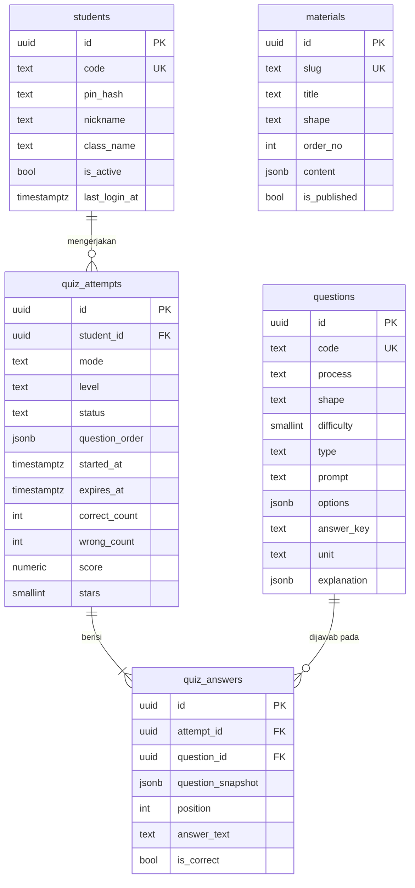

# Rancangan Database — Supabase PostgreSQL

Skema lengkap dan dapat dijalankan: [`supabase/schema.sql`](../supabase/schema.sql). Contoh akun siswa: [`supabase/seed_students.sql`](../supabase/seed_students.sql).

## 1. Diagram relasi



## 2. Penjelasan tabel

| Tabel | Fungsi | Kolom penting |
|---|---|---|
| `students` | Akun siswa yang dibuat guru | `code` unik (pola `A-Z0-9-`), `pin_hash` bcrypt, `nickname` (nama samaran, bukan nama asli), `is_active` |
| `materials` | 4 materi; isi berupa daftar blok JSON (teks, rumus, langkah, gambar, contoh) | `slug`, `order_no`, `content` |
| `questions` | Bank soal **evaluasi** + kunci jawaban + pembahasan | `process` (formulate/employ/interpret), `type` (mc/numeric), `answer_key`, `tolerance`, `explanation` |
| `quiz_attempts` | Satu sesi latihan (per level) atau evaluasi | `mode`, `status`, `question_order` (urutan acak soal & opsi), `expires_at` (batas 30 menit), `score`, `stars` |
| `quiz_answers` | Jawaban per soal | `question_id` (evaluasi) **atau** `question_snapshot` (latihan acak), `answer_text`, `is_correct` |

Primary key semua tabel memakai **UUID** (`gen_random_uuid()`) agar id tidak bisa ditebak berurutan.

## 3. Mekanisme login kode siswa

1. Guru membuat baris `students` dengan `pin_hash = extensions.crypt('<PIN>', extensions.gen_salt('bf'))` (SQL) atau menjalankan `python scripts/add_student.py KB-004 4567 "Kenari" --class VIII-A`.
2. Siswa mengirim kode + PIN ke `POST /api/auth/login`.
3. Backend (dengan secret key) mengambil baris berdasarkan `code` dan `is_active = true`, lalu memverifikasi PIN dengan `bcrypt.checkpw`. Hash `$2a$` dari pgcrypto kompatibel dengan pustaka `bcrypt` Python.
4. Jika cocok, backend menerbitkan JWT berisi `sub = students.id`. Semua kueri data siswa berikutnya memakai filter `student_id = sub`.

Detail lengkap (pembatas percobaan, masa berlaku token): [architecture.md §3](architecture.md#3-mekanisme-login-kode-siswa).

## 4. Row Level Security (RLS)

RLS **aktif di kelima tabel**.

| Tabel | anon (kunci publik) | authenticated | Backend (secret key) |
|---|---|---|---|
| `students` | ditolak (tanpa policy, hak dicabut) | ditolak | penuh (melewati RLS) |
| `questions` | ditolak — melindungi kunci jawaban | ditolak | penuh |
| `quiz_attempts` | ditolak | hanya baris dengan `student_id` = klaim `student_id` di JWT Supabase (hak tabel tetap dicabut) | penuh |
| `quiz_answers` | ditolak | hanya jawaban dari attempt miliknya (hak tabel tetap dicabut) | penuh |
| `materials` | `SELECT` baris `is_published` | `SELECT` baris `is_published` | penuh |

Mengapa siswa tetap hanya mengakses datanya sendiri walaupun backend melewati RLS? Karena **otorisasi dilakukan di FastAPI**: setiap endpoint data siswa mengambil `student_id` dari token yang ditandatangani server — bukan dari parameter yang dikirim browser — dan selalu menambahkan filter `student_id=eq.<sub>`. Uji otomatis `test_cannot_read_other_students_attempt` memastikan siswa A tidak dapat membuka attempt siswa B (respons 404).

## 5. Keamanan kunci

| Kunci | Lokasi | Boleh di frontend? |
|---|---|---|
| `SUPABASE_SECRET_KEY` (secret key `sb_secret_…` atau *service_role* lama) | Env Render saja | **Tidak pernah** |
| `APP_JWT_SECRET` | Env Render saja | **Tidak pernah** |
| *Publishable/anon key* | Tidak dipakai | Tidak diperlukan |

## 6. Seed konten

Materi dan soal evaluasi bersumber dari `backend/app/data/materials.json` dan `questions.json`. Setelah `schema.sql` dijalankan:

```bash
cd backend
python scripts/seed_supabase.py      # upsert materials & questions berdasarkan slug/code
```

## 7. Kueri berguna untuk guru

```sql
-- Rekap nilai semua siswa
select * from public.rekap_nilai;

-- Nilai evaluasi terbaik per siswa
select s.code, s.nickname, max(a.score) as nilai_terbaik
from quiz_attempts a join students s on s.id = a.student_id
where a.mode = 'evaluasi' and a.status = 'submitted'
group by s.code, s.nickname order by s.code;

-- Soal evaluasi yang paling sering salah
select q.code, q.process, count(*) filter (where not qa.is_correct) as salah, count(*) as total
from quiz_answers qa join questions q on q.id = qa.question_id
group by q.code, q.process order by salah desc;
```
