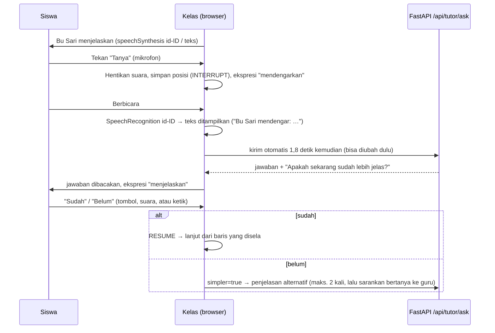

# Interaksi Suara

## 1. Pilihan teknologi & alasannya

| Opsi | Realtime 2 arah | Pengguna < 18 | Biaya | Keputusan |
|---|---|---|---|---|
| **Web Speech API** (browser) + mesin tutor FastAPI | Mendekati realtime (giliran bicara, interupsi lewat tombol) | Tidak ada syarat API pihak ketiga | Gratis | **Dipakai** |
| OpenAI Realtime API (WebRTC + token sementara) | Ya, latensi rendah, interupsi bawaan | Boleh dengan pengaman tambahan | ±$0,02/menit masuk + ±$0,08/menit keluar (sumber pihak ketiga) | Opsi masa depan, perlu persetujuan biaya |
| Google Gemini Live API | Ya | **Dilarang** oleh syarat API (aplikasi yang kemungkinan diakses < 18 tahun) | Ada tier gratis | Tidak dipakai |
| Claude API | Tidak ada model suara; dipakai sebagai "otak" teks | Boleh dengan pengaman | Per token | Opsional (`ANTHROPIC_API_KEY`) |

## 2. Alur percakapan

## 3. Penanganan kondisi
| Kondisi | Perilaku |
|---|---|
| Browser tanpa `SpeechRecognition` | Tombol mikrofon nonaktif; siswa mengetik |
| Izin mikrofon ditolak (`not-allowed`) | Pesan cara mengizinkan + kotak ketik tetap aktif |
| Tidak ada suara terdengar (`no-speech`) | Pesan untuk mencoba lagi |
| Tidak ada suara `id-ID` untuk TTS | Penjelasan tampil sebagai subtitle dengan durasi baca; tidak memakai suara bahasa lain |
| Offline / server tidak bisa dihubungi | Pesan koneksi; posisi pelajaran tetap tersimpan; tombol "Kembali ke pelajaran" |
| Layanan AI gagal / menolak | Backend kembali ke jawaban curated |
| Terlalu banyak bertanya | 429 dengan pesan ramah |

## 4. Privasi
- Aplikasi **tidak merekam atau menyimpan audio**. Pengenalan suara dilakukan oleh fitur browser (Chrome memprosesnya melalui layanan Google).
- Hanya teks pertanyaan yang dikirim ke backend; riwayat percakapan tidak disimpan di database.

## 5. Keterbatasan yang jujur
- Ini bukan *full-duplex*: siswa menyela dengan menekan tombol, bukan dengan langsung berbicara saat guru sedang bersuara.
- Kualitas suara dan pengenalan bergantung pada perangkat. Di Android, suara Bahasa Indonesia biasanya tersedia lewat Google TTS. Periksa di **Setelan → Bahasa → Output text-to-speech**.
- Belum diuji dengan mikrofon sungguhan di HP fisik (lihat `testing.md`). Uji otomatis memakai pengenalan suara tiruan.

## 6. Konfigurasi
| Variabel | Lokasi | Keterangan |
|---|---|---|
| `ANTHROPIC_API_KEY` | backend (Vercel/Render) | Opsional. Kosong = mode curated gratis |
| `TUTOR_MODEL` | backend | Bawaan `claude-opus-5-5`; `claude-haiku-5-5` jauh lebih murah |
| `TUTOR_MAX_REQUESTS` | backend | Batas pertanyaan per siswa per 10 menit (bawaan 30) |

Perkiraan biaya Claude per pertanyaan (±2.000 token masuk, ±200 token keluar): Opus 5.5 ≈ $0,012; Haiku 5.5 ≈ $0,0003. Kebanyakan pertanyaan dijawab oleh mesin curated tanpa memanggil AI.
