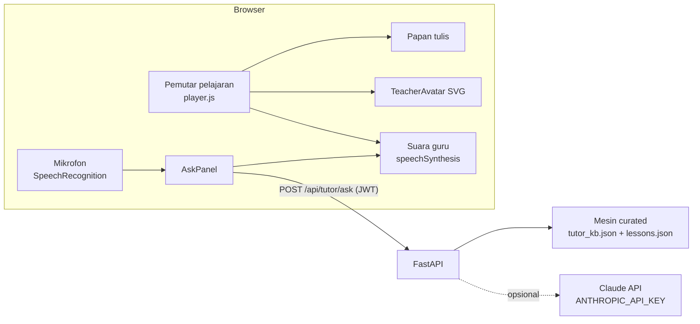

# Guru Virtual "Bu Sari"

## 1. Ringkasan
Bu Sari adalah karakter guru 2D yang menjelaskan materi di samping papan tulis digital. Siswa dapat menyela dengan suara atau ketikan, mendapat jawaban yang sesuai materi, lalu guru melanjutkan dari posisi terakhir.

## 2. Karakter (Fase C)
- File (v3.1, ditulis ulang dari nol): `frontend/src/features/characters/Teacher.jsx`, `parts.jsx`, `characters.css`. SVG buatan sendiri (bukan aset pihak ketiga).
- **Ekspresi**: `neutral`, `happy`, `explaining`, `thinking`, `listening`, `proud`.
- **Pose**: `idle`, `wave`, `talk` (gerak tangan), `point` (menunjuk papan), `listen` (tangan di telinga), `think` (tangan di dagu), `cheer`.
- Animasi ringan: napas, kedip, mulut bergerak saat berbicara, lambaian. Hanya `transform`/`opacity`; dimatikan saat "kurangi gerakan".
- Pemetaan status → ekspresi ada di `teacherLook()` (`features/classroom/player.js`).

## 3. Pelajaran bersegmen (Fase D)
Sumber: `backend/app/data/lessons.json` (4 pelajaran, 14 segmen), disajikan oleh `GET /api/lessons` dan `GET /api/lessons/{slug}`.

| Field segmen | Isi |
|---|---|
| `id`, `title`, `goal` | identitas & tujuan pembelajaran |
| `concept` | kunci konsep (dipakai tutor untuk memprioritaskan jawaban yang relevan) |
| `board[]` | butir papan: `title`, `line`, `formula`, `figure`, `tip`, `pair` |
| `script[]` | naskah: `say` (≤ 220 huruf), `show` (butir papan yang ditampilkan & ditunjuk), `pose`, `expression` |
| `check` | soal cek pemahaman (opsional) |

Aturan konten (diuji di `tests/test_lessons.py`): kalimat pendek, indeks papan valid, dan **tidak ada angka soal evaluasi** di naskah.

Kontrol: Mulai · Jeda · Lanjutkan · Ulangi bagian · Bagian sebelumnya/berikutnya · Lompat ke bagian (titik nomor) · Suara on/off · Tanya.

## 4. Kecerdasan pedagogis (diperbarui 16 Nov 2026)
`POST /api/tutor/ask`:
- **AI aktif** (`ANTHROPIC_API_KEY` diisi di backend): **semua** pertanyaan dijawab Claude agar jawaban alami dan mengikuti percakapan (ingatan 10 giliran terakhir). Hanya perintah "ulangi" yang tetap memutar ulang penjelasan papan. Jika AI gagal/menolak → jawaban siap pakai (curated).
- **Tanpa AI** (bawaan, gratis): perhitungan terpandu, permintaan khusus segmen, bank tanya-jawab (`tutor_kb.json`, 25 intent termasuk *bernalar-memilih* dan *memeriksa-pekerjaan*). Jawaban yang persis sama dengan jawaban sebelumnya tidak diulang: diganti versi lebih sederhana, lalu ajakan menjelaskan bagian yang belum jelas.
- Jawaban selalu **dibacakan Bu Sari** (Web Speech API) dengan gerak bibir per kata.

*System prompt* AI (`claude_provider.py → RULES`) mengikuti metode **RMT** (lihat [rmt.md](rmt.md)): intensionalitas & resiprositas, makna, transendensi, fase Input–Elaborasi–Output, alat psikologis (jaring-jaring, tabel pasangan sisi, rumus, bahasa matematika), pertanyaan termediasi dengan petunjuk bertahap (ZPD), validasi & refleksi, serta empat indikator literasi. Aturan keamanan tetap: mengaku program komputer, menolak topik di luar materi, tidak meminta data pribadi, tidak mengarang rumus.

## 5. Manajemen konteks & kelanjutan
| Disimpan | Di mana |
|---|---|
| Modul, segmen, baris (posisi penjelasan) | `localStorage` `kb_lesson_<kode>_<slug>` setiap kali berubah |
| Status interupsi (posisi sebelum bertanya) | state `resume` di reducer; disimpan sebagai posisi |
| Pertanyaan & jawaban sesi ini | state panel (dikirim maksimal 6 giliran terakhir sebagai konteks) |
| Status pemahaman | alur "Sudah paham?" → `classifyUnderstanding()` (sudah/belum) |
| Pelajaran selesai | `kb_lesson_done_<kode>` → progres di beranda |

Setelah tanya-jawab, `RESUME` mengembalikan ke **baris yang disela** (baris itu diucapkan ulang), bukan ke awal materi. Riwayat percakapan dan rekaman suara **tidak disimpan** di server.

## 6. Pengaman untuk pengguna di bawah umur
- Pemberitahuan bahwa Bu Sari adalah program komputer (daftar kelas, panel tanya, Petunjuk) — sesuai panduan Anthropic untuk organisasi yang melayani anak.
- Topik dibatasi; pertanyaan di luar topik ditolak.
- Batas 30 pertanyaan / 10 menit per siswa (`TUTOR_MAX_REQUESTS`).
- Tidak ada kunci API di browser; tidak ada data pribadi yang dikirim selain teks pertanyaan.
- Google Gemini API **tidak dipakai** karena syaratnya melarang aplikasi untuk pengguna di bawah 18 tahun.

## 7. Menambah intent / naskah
1. Edit `backend/app/data/tutor_kb.json` atau `lessons.json`.
2. Jalankan `python -m pytest` (integritas naskah, kebocoran soal evaluasi, intent).
3. Deploy ulang backend. Konten pelajaran tidak perlu di-*seed* ke Supabase (dibaca dari JSON).
